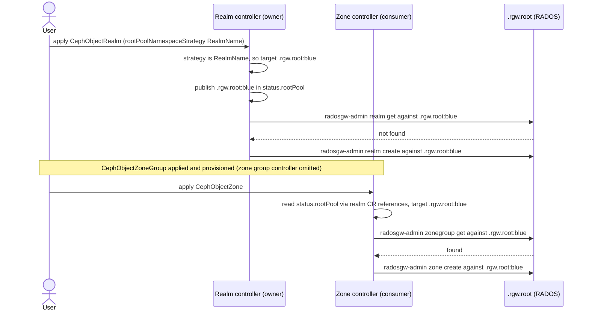
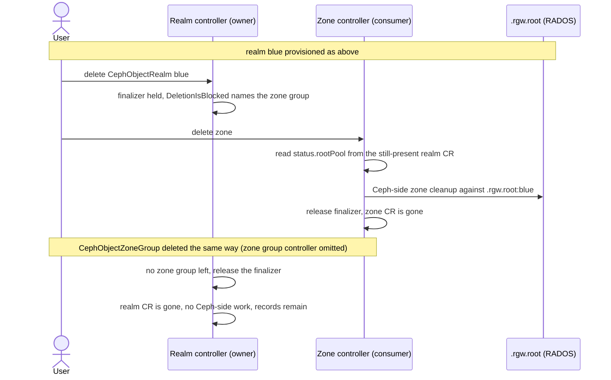

# Namespaced RGW Topology Pool (`rootPoolNamespaceStrategy`)

Store a realm's RGW topology records in a RADOS namespace of `.rgw.root` instead of using the raw `.rgw.root` pool.

## Summary

`sharedPools` collapses a store's data and metadata into shared pools partitioned by RADOS
namespaces, which are named after the zone name. The **RGW topology records** — realm, zone group, zone, and
period — are not covered by this feature. Instead every store in the cluster keeps the realm information together in a single, un-namespaced `.rgw.root` pool.

To mitigate this we propose a new `rootPoolNamespaceStrategy` field.
`rootPoolNamespaceStrategy: RealmName` should be an opt-in setting for storing a realm's topology records in a RADOS namespace of `.rgw.root`. A store using `sharedPools` together with `rootPoolNamespaceStrategy` would then have its entire RADOS footprint (data, metadata, and topology) stored with RADOS namespaces.

### Motivation

- **Enabling realm separation at the cephx level.** With `rootPoolNamespaceStrategy` and `sharedPools`
  together, a realm's entire RADOS footprint (data, metadata, and topology) would lie in
  distinct RADOS namespaces. A Rook user could then achieve cephx-enforced realm separation by manually provisioning an RGW instance with a cephx user scoped to those namespaces (the user's mon caps must use the [`profile rgw`](https://github.com/ceph/ceph/pull/70538) cap profile; a bare `mon 'allow rw'` would undermine the separation).
  Separating realms like this closes confidentiality gaps between realms. For example, the zone record in `.rgw.root` carries the realm's `system_key` (the
  credentials used for multisite replication) in cleartext, so under broad OSD
  capabilities any RGW can read another realm's replication credentials out of the
  shared pool. An OSD capability scoped to the realm's namespaces stops that read.
- **Decrease coupling of realms stored in the same `.rgw.root` pool.** If every realm shares a `.rgw.root` pool then every `radosgw-admin` invocation can reach any realm, so a wrong `--rgw-realm`, a default-realm-fallback commit, or a `realm list` delete sweep can hit a neighboring realm. Invoking any `radosgw-admin` command against a namespace-separated realm would not influence realms living in other namespaces.

    Keeping each realm in a separate RADOS namespace would also help with:
    - Backing up realm topology: back up the RADOS namespace
    - Deleting a realm: delete every RADOS namespace associated with it
- **No reliance on the root pool's default location.** Every `radosgw-admin` invocation implicitly relies on the root pool location being `.rgw.root` and Rook relies on that default today. Rook otherwise tries consistently to be explicit rather than depend on defaults.

### Goals

- Opt-in partitioning of `.rgw.root` by RADOS namespace, for single-site and multisite setups.
- Off by default: existing stores, and stores that do not set the
  field, should be untouched and keep using the shared `.rgw.root`.
- Backward compatible: existing shared `.rgw.root` stores and realms should be untouched, and enabling
  the feature should never rewrite or migrate an already-provisioned layout. (Operator downgrade is
  not supported by Rook. See Open Question 2.)
- Should apply to newly created realms and object stores only.

### Non-Goals

- Relocating existing shared `.rgw.root` topology to a RADOS namespaced `.rgw.root` (and the other way around)
    - `rootPoolNamespaceStrategy` is immutable on a CR, so the layout cannot be flipped in place. Deleting a realm
      and re-creating it under the same name with the other layout is accepted, but this does not cause a
      migration. Instead it provisions at the new location and leaves the old records orphaned.
- Configurable namespace or pool names. The pool would always be `.rgw.root` and the namespace
  always the realm name. No new naming knobs are introduced.
- Changing the `sharedPools` data/metadata model or its API.
- Access control. This feature would control the placement of topology records. It would not change
  what any RGW daemon or client is authorized to read or write. It would, however, arrange the
  layout that namespace-scoped cephx capabilities require (see Motivation).
- Automated Ceph-side cleanup of multisite realms. The prerequisite finalizers (see Prerequisite
  work) only order the deletion of the CRs.

### Constraints and assumptions

The design builds on the following pre-existing behaviors and accepts the constraints they impose:

- In Rook (up-to-date as of v1.21), deleting a `CephObjectRealm` CR in multisite does not delete the realm on the Ceph side. CephObjectRealm's reconcile performs no Ceph-side work on delete. In contrast, in single-site `CephObjectStore` teardown the associated realm records are removed. This design is intended to make no requirement either way, thus allowing CephObjectRealm to delete the Ceph-side realm in the future.
- **Consumers already wait for their parent's topology records.** Before writing anything, the zone group,
  zone and store controllers each run a Ceph-side `radosgw-admin` read of their parent's record and try
  again later if it is missing. The design relies on this existing
  ordering, i.e., a consumer never has to act before the records it depends on exist, because it waits
  instead.
- **The root pool location is cluster-local.** RGW and `radosgw-admin` resolve the root pool from
  their local configuration, and no multisite exchange (`realm pull`, `period pull`, replication)
  carries a pool location. A realm's `rootPoolNamespaceStrategy` value therefore needs to be consistent
  only within a cluster. Peering with clusters that do not know the field, such as non-Rook peers
  or Rook releases before this feature, is unaffected (see the Multisite DR operational note).


## Glossary

- Root pool: The pool an RGW reads its initial state from. It holds the RGW topology records an RGW needs in order
  to start. Default location `.rgw.root`.
- RGW topology records: the RADOS objects RGW stores in a root pool to describe the multisite layout.
- Parent CR: the CR one step up the Rook CR spec chain "realm → zone group → zone → object store".
  A zone group's parent is the realm, a zone's parent is its zone group, an object store's parent is its zone;
  the realm has no parent. A CR's controller reads the parent CR's record before writing its own and never
  creates it. This applies to multisite only, since a standalone `CephObjectStore` creates the realm,
  zone group, and zone records itself.
- Consumer controller: a controller that reads the root pool location from the `status.rootPool` of a realm CR it does not own.
- Owner CR: the CR that carries `rootPoolNamespaceStrategy`. For a standalone store the `CephObjectStore` CRD carries the `rootPoolNamespaceStrategy` field, and in multisite the `CephObjectRealm` CRD does. The `CephObjectRealm` and `CephObjectStore` controllers are the only ones that create the realm's records.
- Root pool location: a root pool together with an optional RADOS namespace, written `pool[:namespace]`. Under this
  design a realm's root pool location is either the shared `.rgw.root` or `.rgw.root:<realm>`.

## Proposal details

### API

One string enum field with a single value, `RealmName`, defined at two authorities:

```yaml
# Single-site: CephObjectStore is the authority.
apiVersion: ceph.rook.io/v1
kind: CephObjectStore
spec:
  sharedPools:            # optional; rootPoolNamespaceStrategy works with or without sharedPools
    metadataPoolName: rgw-meta-pool
    dataPoolName: rgw-data-pool
  rootPoolNamespaceStrategy: RealmName  # topology in .rgw.root:<store-name>
```

```yaml
# Multisite: CephObjectRealm is the authority; zone group, zone, and store follow it.
apiVersion: ceph.rook.io/v1
kind: CephObjectRealm
spec:
  rootPoolNamespaceStrategy: RealmName  # topology in .rgw.root:<realm-name>
```

Shaping decisions:

- **`rootPoolNamespaceStrategy` does not require `sharedPools`.** Reconciling the realm CR is what
  initializes the realm in the root pool, so the multisite `rootPoolNamespaceStrategy` field must live on
  CephObjectRealm, while `sharedPools` sits on the CephObjectZone CRD. Coupling the two across CRDs is
  therefore not possible in multisite, and for consistency the single-site `CephObjectStore` case does
  not require it either.
- **The root pool namespace will be the realm name (`.rgw.root:<realm>`).** Topology records are realm-scoped, unlike the
  sharedPools zone-scoped data/metadata namespaces. In single-site, Rook names the realm after the store.
- **A string enum.** `rootPoolNamespaceStrategy` takes a closed set of values, today only
  `RealmName`. Leaving the field out or setting it to the empty string keeps the shared `.rgw.root`.
  An operator that does not know a value refuses to reconcile the CR instead of provisioning at the
  shared `.rgw.root`. A bool could only express on and off, and a
  later placement variant would need a second field next to it. With the enum a later variant is a
  new value of the same field (see Open Question 1). Pool and namespace names are not configurable.

Validation:

- **The `rootPoolNamespaceStrategy` field should be immutable once set**. A realm's topology records
  cannot be relocated once written. RGW offers no supported way to move them to another root pool
  location. The pool location is therefore fixed when the realm or store is created. The field has
  no CRD default. A CR that leaves it out keeps the shared `.rgw.root` and nothing is written into
  its stored spec. Immutability constrains updates only. A CR
  that is deleted and recreated with the other layout presents no previous spec and is accepted.
- **`rootPoolNamespaceStrategy` should be set on the CR that owns the realm** — the `CephObjectStore` for a
  standalone store, the `CephObjectRealm` in multisite. A store that joins a zone (`zone.name`
  set) does not own its realm, so setting the field there should be rejected.

CRD enforcement:

Both validations are enforced at the CRD level, so the Kubernetes API server rejects an invalid spec
before it ever reaches a controller. On both `ObjectStoreSpec` and `ObjectRealmSpec`:

```go
// +kubebuilder:validation:Enum="";RealmName
// +kubebuilder:validation:XValidation:message="rootPoolNamespaceStrategy is immutable",rule="self == oldSelf"
// +optional
RootPoolNamespaceStrategy string `json:"rootPoolNamespaceStrategy,omitempty"`
```

The rule that a store joining a zone cannot own its realm is a whole-object CEL rule on
`ObjectStoreSpec`, mirroring the existing `defaultRealm`/`zone.name` exclusion on the same struct:

```go
// +kubebuilder:validation:XValidation:rule="!(has(self.rootPoolNamespaceStrategy) && self.rootPoolNamespaceStrategy != '' && has(self.zone) && size(self.zone.name) > 0)",message="rootPoolNamespaceStrategy must not be set on a store that joins a zone; in multisite the CephObjectRealm carries the field"
```

CEL validation rules run on every write, not only at creation. This matters because `zone.name` is
mutable. A create-time-only check would accept a namespaced standalone store that is later changed to
join a zone.

Controller enforcement:

When `rootPoolNamespaceStrategy` gains the value `RealmName` on an existing CR, or loses it, the
owner controller (the realm controller in multisite, the store controller in single-site) runs a
**location agreement check** for the root pool location. The immutability rule does not catch such
an edit.

At the start of every reconcile, before any `radosgw-admin` call, the owner derives the root pool
location from the spec and compares it with the location published in the CR's `status.rootPool`
(see Status):

- **The CR has no status yet.** The CR is new. The owner sets `status.rootPool` from the spec in
  its first status write, before it writes any topology record.
- **The CR has a status but `status.rootPool` is empty.** An operator before this feature
  provisioned the CR at the shared `.rgw.root`. The owner sets `status.rootPool` to `.rgw.root`.
- **`status.rootPool` matches the location derived from the spec.** The reconcile proceeds.
- **`status.rootPool` differs from the location derived from the spec.** The owner refuses to
  reconcile, sets the phase to failure, and records an event naming both locations.

`status.rootPool` is the single source of truth for the root pool location. The check runs on
every reconcile, also while the CR is being deleted.

Status:

The realm's status today is the generic phase and conditions status that other CRDs share as well.

To surface the resolved location (see Observability), the realm gets a dedicated status type, and
both the realm and the store gain a named `rootPool` status field. The field holds the root pool
location as `pool[:namespace]`, and its API documentation describes it as the location of the
realm's topology records. It is set for every realm and store,
also when the location is the shared `.rgw.root`. The realm's status should look like this:

```yaml
status:
  phase: Ready
  rootPool: .rgw.root:<realm-name>
```

### Mechanism

Ceph uses these four options, `rgw_realm_root_pool`, `rgw_zonegroup_root_pool`,
`rgw_zone_root_pool`, and `rgw_period_root_pool`, to set the RGW root pool (default is `.rgw.root`). Ceph parses each value as `pool[:namespace]`, so setting them to `.rgw.root:<realm-name>` keeps the same pool but confines the records to a RADOS namespace. When a realm's resolved layout is namespaced, Rook should set all four options to `.rgw.root:<realm-name>`. This must be propagated on every `radosgw-admin` call and in the RGW daemon's startup flags (its pod container arguments).

When the resolved layout is not namespaced, Rook should emit none of the four options and keep
today's behavior. Emitting them unconditionally, with `.rgw.root` for an un-namespaced layout,
would silently take over the options for stores that never opted into this feature but customized
their root pool via `rgwConfig` or ceph.conf (see risk 4). Leaving the options unset there is a
deliberate exception to the no-reliance-on-defaults motivation, since being explicit would override
user customization.

### Prerequisite work

In multisite, every consumer controller resolves the root pool location from the realm CR through
the CR reference chain, so the realm CR must exist for as long as any consumer does. Kubernetes
alone does not guarantee that. It enforces no deletion order between resources, a whole-setup
teardown (`kubectl delete -f`, namespace deletion) removes all CRs at once, and only a finalizer
makes a CR linger. Without the prerequisite work below, only `CephObjectZone` and `CephObjectStore`
are deletion-gated by finalizers, so during a multisite teardown the realm CR can disappear while
consumers still need it to read the root pool location. Single-site is unaffected, since a
standalone `CephObjectStore` carries the field itself and no CR chain is involved.

This design therefore requires prerequisite work that lands before the implementation
([rook#18452](https://github.com/rook/rook/pull/18452)). `CephObjectRealm` and `CephObjectZoneGroup`
gain finalizers, added at reconcile time. A deleted realm CR keeps its finalizer until no
`CephObjectZoneGroup` references it, and a deleted zone group CR keeps its finalizer until no
`CephObjectZone` references it. Zones already wait for their object stores while the zone is part
of its Ceph zone group, so a whole-setup teardown completes in order without manual steps. While
the deletion is blocked, the CR's `DeletionIsBlocked` status condition names the dependents that
block it. When the whole CephCluster is gone, or is deleted with a cleanup policy, the finalizer is
released, matching the existing behavior of every finalizer-gated Rook CR.

The prework performs no Ceph-side cleanup (see Non-Goals). It only guarantees that the realm and
zone group CRs are deleted after the CRs that reference them. Every consumer can then
rely on the realm CR existing for as long as the consumer itself exists, during provisioning and
during deletion.

### How do controllers get the correct root pool location?

Every controller that issues a `radosgw-admin` command, and every RGW pod that is rendered, needs to
know whether a realm's RGW topology records belong to the shared `.rgw.root` pool or to the realm's own
`.rgw.root:<realm>` RADOS namespace. Resolution rests on one principle:

> The `rootPoolNamespaceStrategy` field on the owner CR decides the root pool location when the CR is created. The owner
> publishes that location in `status.rootPool`, and from then on every controller reads it from there.
> Ceph is never asked where the topology records are.
> If the location cannot be read at the moment, the controller requeues and tries again later. The root pool location is never guessed.

That yields the following rules.

**Resolution.** Consumers should read `status.rootPool` from the `CephObjectRealm` CR. They can do it via the
reference chain: `CephObjectStore.spec.zone.name` →
`CephObjectZone.spec.zoneGroup` → `CephObjectZoneGroup.spec.realm` → the realm CR. In single-site, the
store owns the field and derives the location from its own spec.
For the store and the zone group controller this adds no new
dependency. The store already fetches the realm CR to resolve realm/zone-group/zone names and the
zone group controller already reads the realm CR. However, the zone controller
gains a new read since currently it takes only the realm name from the zone group CR and never fetches the
realm CR itself.

**Provisioning.** The *owner* (the realm controller in multisite, the store controller in single-site) publishes
the location in `status.rootPool` before it writes the first topology record (see Controller
enforcement). Otherwise the owner keeps its
current behavior, i.e., it calls `radosgw-admin realm get` at the resolved location and `realm create`
when the realm is not found, but now it does so with the four root-pool options set from the resolution.

**Reconciling and deleting wait if the root pool location cannot be resolved.** If a consumer cannot
read the realm CR, or the realm CR has no `status.rootPool` yet, while creating, reconciling, or
deleting, it requeues with an error and tries again later. It never guesses and never consults Ceph to
determine the root pool location. This mirrors the timed requeue consumers already use for a missing
or not-ready parent CR (the zone controller requeues today when the zone group CR is not ready).
After the operator upgrade that introduces this feature, existing realms have no `status.rootPool`
until the realm controller has reconciled them once, and their consumers requeue until then. The
prerequisite finalizers keep the realm CR
present for as long as any consumer exists, so an unreadable realm CR is a transient condition or the
result of a manually removed finalizer. In the manual case the consumer's deletion stays blocked,
with the error naming what is missing, until the administrator recreates the realm CR with the same
spec or also removes the consumer's finalizer.

**Example — provisioning (multisite).** The following diagram shows how a realm `blue` with
`rootPoolNamespaceStrategy: RealmName` is provisioned. The owner (the realm controller) resolves the field,
publishes `.rgw.root:blue` in `status.rootPool`, and creates the realm there. One consumer (the zone
controller) reads `status.rootPool` via the CR references and creates the zone at the same location. The store and zone-group controllers resolve the layout
identically and are omitted, as are the RGW pods. Once the zone exists, the store controller deploys
them with the four root-pool options in the pod args.



**Example — teardown (multisite).** The following diagram shows a whole-setup teardown under the
prerequisite finalizers. The realm CR is deleted first, but its finalizer holds it while the zone
still exists, so the zone controller can resolve the root pool location and run its Ceph-side
cleanup at the right place. After the dependents are gone, the realm controller releases its
finalizer and the realm CR is deleted. Single-site has no counterpart to this ordering concern since the
`CephObjectStore` owns the field itself, so the location is always resolvable during the store's
own teardown.



### Risks and Mitigation

1. **Wrongfully deleting `.rgw.root` when it is still in use by another realm.** Only a single-site
   `CephObjectStore` teardown deletes the `.rgw.root` *pool*, and only when `preservePoolsOnDelete` is
   false, the store declares its own metadata/data pools, and `radosgw-admin realm list` indicates that no
   other realm still uses the pool. The problem with this check is that namespacing makes that list
   incomplete. Each `realm list` reports only the realms in the location it is pointed at, so a store can
   read a list with no other realms while another realm's topology is still present in a different
   namespace, and Rook would delete the whole shared `.rgw.root` pool and every realm's topology in it.

   Retaining `.rgw.root` while another realm's records exist is pre-existing behavior. The deletion
   gate reads `realm list`, and Rook never deletes multisite realm records, so a leftover multisite
   realm already keeps the pool from being reclaimed today. The occupancy check adds no new
   retention policy. It only re-establishes the precondition that no other realm still uses the
   pool, which a single un-namespaced `realm list` used to establish on its own.
    - Mitigation: a two-step occupancy check must pass before Rook deletes the `.rgw.root` pool. See
      **The `.rgw.root` occupancy check** below.
2. **Outdated CRDs during upgrade window.** The standard Rook upgrade order, CRDs before the
   operator, applies. New namespaced stores or realms should not be created until the operator
   rollout has completed. Neither point is specific to this feature, so no feature-specific
   handling is added.
3. **Deletion without realm CR.** In multisite the realm CR is the only source of the root pool
   location, so without it no delete operation that depends on the root pool options is possible. (Single-site the
   field is on the `CephObjectStore` being deleted, so it is always readable during its own teardown.)
   - Mitigation: the prerequisite finalizers keep the realm CR present while consumers exist (see
     **Prerequisite work**). If an administrator removes the realm finalizer by force, consumer
     deletion blocks with an error.
4. **RGW root pool options redefined in the gateway spec.** A user can specify `rgw_realm_root_pool`,
`rgw_zonegroup_root_pool`, `rgw_zone_root_pool`, `rgw_period_root_pool`, or the obsolete
`rgw_region_root_pool` through three channels: `spec.gateway.rgwConfig`,
`spec.gateway.rgwConfigFromSecret` and
`spec.gateway.rgwCommandFlags`. Any of them can collide with values set by
`rootPoolNamespaceStrategy`.
    - Mitigation: none by design. These channels exist so that users can override what Rook
      sets, and Rook should not hinder them.
#### The `.rgw.root` occupancy check (mitigation of risk 1)

Each `radosgw-admin realm list` reports only the realms in the location it is pointed at, so a store can read a
list without another realm's records while they are still present. Before deleting the `.rgw.root` pool,
Rook should therefore verify that no RADOS namespace in the pool still holds a realm:

1. `rados --pool .rgw.root --all ls` reports the RADOS namespace of every object in the pool (including the default (empty) namespace). This is
   the only way to discover which namespaces exist at all, because a RADOS namespace has no existence
   apart from the objects that carry it.
2. For every detected RADOS namespace, run `radosgw-admin realm list` with the four root-pool options
   pointed at the namespace's root pool location.

The check has three outcomes, and only one of them deletes `.rgw.root`:

- **Provably empty**: every command succeeded and no location reports a realm. `.rgw.root` stays in
  the delete set.
- **Occupied**: a location reports a realm. `.rgw.root` is still in use and is dropped from the
  delete set.
- **Inconclusive**: the namespace listing or a `realm list` fails or times out. The check cannot
  prove `.rgw.root` is unused, so this counts as occupied. Rook drops `.rgw.root` from the delete
  set and logs a warning naming the pool and the reason.

The check gates only whether `.rgw.root` joins the delete set. On the occupied and inconclusive
outcomes the store's own pools are still deleted and the teardown completes, so a refusal never
wedges the store's deletion, and retaining `.rgw.root` is already the normal outcome whenever
another realm exists.

Rook runs the check right before it deletes `.rgw.root`. A failed `realm rm` earlier in the
teardown is only logged, so the check can still find the store's own records and count them as
occupancy. That outcome retains `.rgw.root` and the teardown still completes, which fails safe.

Listing the whole pool sounds expensive but is not at this size, and the check only runs during a
delete operation, never in a steady-state reconcile. Rook creates `.rgw.root` with `pg_num` 8, and the
pool holds nothing but topology records (roughly ten objects per realm, plus one per committed period
epoch). librados fetches object names in batches of up to 1024 per request, asking each PG in turn, so
a cluster with a few dozen realms may still be listed in one request per PG, eight in total. Each
request reads the OSD object index rather than object data. It would be far more expensive against a
pool that is not what Rook created, for instance if the root-pool options were pointed at a pool
holding bulk data.

### Operational notes

- **Deletion**: the prerequisite finalizers order the teardown. Consumers delete themselves first,
  while the realm CR still resolves the root pool location, and the realm and zone group CRs go
  last. A forcibly removed finalizer leads to error-and-requeue on the consumers, never to a silent
  skip (risk 3).
- **Upgrade order**: CRDs before operator (the standard Rook order). Applying them in the other order
  prunes the field at admission, so a store that asks for namespacing provisions un-namespaced instead
  and nothing at runtime detects it (risk 2). Because the operator rollout is not atomic, new
  stores or realms with `rootPoolNamespaceStrategy` set should not be created until the rollout has completed
  (risk 2). Operator downgrade is not supported by Rook (see Open Question 2).
- **Multisite DR**: the root pool location is cluster-local (see Constraints and assumptions), so the
  source realm and a pull realm (`spec.pull.endpoint` set) may resolve different locations without
  affecting `realm pull` or replication. Setting `rootPoolNamespaceStrategy` uniformly across the clusters
  is still recommended. The cephx separation and the decoupling benefits apply only to the clusters
  where the realm is namespaced. Each cluster's resolved location is surfaced in its realm and store
  statuses (see Observability).
- **Out-of-band tooling**: flag-less `radosgw-admin` (e.g. the toolbox) resolves the default
  `.rgw.root` and will not see namespaced realms unless the four root-pool options are passed explicitly.
- **External-mode stores**: an external-mode CephObjectStore runs no local RGW daemons and
  provisions no topology records, so `rootPoolNamespaceStrategy` would have no effect there.
  The store controller should warn when the field is set on an external
  store.
- **No cluster-wide default realm**: because `default.realm` lives in the realm root pool, it too
  would become per-namespace. There would be no single default realm spanning namespaced realms, and
  `SetDefaultRealm` would only mark a realm default within its own namespace. A flag-less lookup would
  still resolve the default in the shared `.rgw.root`, not any namespaced realm.

### Observability

The effective root-pool location should be **published in the CR's `status.rootPool`** field (see
Status):

- `CephObjectStore.status.rootPool`: the location the store controller resolved, `.rgw.root` or
  `.rgw.root:<realm>`.
- `CephObjectRealm.status.rootPool`: the location the realm controller resolved.

This deliberately departs from the `sharedPools` precedent of not reporting resolved data/metadata
namespaces in the status. The root pool location is worth the exception because a consumer cannot
derive it from its own spec, as the field lives on the realm CR.

Whether a realm is namespaced can also be confirmed out of band:

- Inspect the RGW pod's command-line arguments for the four `rgw_*_root_pool` flags set to
  `.rgw.root:<realm-name>`.
- List the pool by namespace: `rados ls -p .rgw.root --all` shows topology objects carrying the
  realm namespace.

### Testing

Test planning (unit and end-to-end) is deferred to the implementation PR.

## Drawbacks

- Flag-less `radosgw-admin` (e.g. the toolbox) cannot see namespaced realms unless the four
  root-pool options are passed explicitly (see Operational notes).
- **Ceph dashboard multisite management (upstream limitation).** The Ceph mgr dashboard's
  multisite management (realm/zone-group/zone create and list, period, replication setup) runs
  `radosgw-admin` through the mgr as `-n mgr.<id>` with no `rgw_*_root_pool` flags
  (`mgr_module.py send_rgwadmin_command`), so it resolves the default `.rgw.root` and cannot see or
  deal with namespaced root pools. Pointing the mgr at a namespaced realm via the mon config
  database (`ceph config set mgr rgw_realm_root_pool ...`) would be honored, but mon-config masks
  cannot express a per-realm scope, so exactly one root-pool location is addressable and every
  other realm would disappear from the dashboard. Serving multiple realms is the case this feature
  exists for, so the limitation stays and a fix belongs upstream.
- There is no cluster-wide default realm spanning namespaced realms (see Operational notes).

## Alternatives

- **Probe Ceph for the layout instead of trusting the CR.** Instead of reading
  the root pool location from the realm CR, each controller could ask Ceph where the realm's records
  actually live, reading both candidate root pool locations and using whichever answers.
    - Rejected because reading the published location is much simpler than interpreting probe results. The main benefit
    of a probe would lie on the deletion path, and only if the realm CR could be gone while a
    consumer still needs it. The prerequisite finalizers close exactly that case. The realm's own
    records (realm and period objects) are also never deleted by Rook in multisite, so the probe's
    deletion-path benefit does not justify the added complexity.
- **Distribute the root pool location to consumers via an annotation.** The operator could
  record the resolved root pool location as an annotation on each CR it provisions, and consumers
  would read that annotation instead of resolving the realm CR through the reference chain.
  - Rejected because it adds complexity without need. Reading the realm's status directly is simpler, and verifying that
  the annotation is still correct would effectively be a cache-verification protocol that introduces
  even more complexity. Annotations also carry none of the CRD-level guarantees the design relies on.
  There is no schema and no immutability rule, so an edited or deleted annotation would
  silently change the resolved layout.

## Open Questions

### 1. Should the root pool be customizable?

The four root pool options accept any `pool[:namespace]`, so nothing in RGW forces
`.rgw.root`. The topology records could live in any pool the user names.

Why don't we place the topology records into the shared **metadata pool** (`rgw-meta-pool:<realm-name>.root`) from the `sharedPools` feature? That would remove `.rgw.root` entirely for such setups (three pools become two).

- See the API section. For multisite we cannot couple `sharedPools` with `rootPoolNamespaceStrategy` as the realm exists before the zone.

Why this design keeps the pool fixed in general:

- **A fixed pool keeps the set of possible locations closed.** This keeps the design simple because the topology records are either in `.rgw.root` or in `.rgw.root:<realm>`.

**Settled. The pool stays `.rgw.root` and the namespace is the realm name.** `rootPoolNamespaceStrategy`
is a string enum with the single value `RealmName`. If a use case for another placement arrives, it
becomes a new value of the same field rather than a second field, so no customization API is needed now.

### 2. How should operator downgrade be handled?

Downgrading the operator below the introducing release re-renders the RGW pods without the
root-pool startup flags, so a redeployed gateway would resolve the shared, un-namespaced
`.rgw.root` instead of its namespace.

**Settled. Operator downgrade is not supported by Rook.** The design adds no backstop for this
case.

### 3. When should the namespace created by `rootPoolNamespaceStrategy` be deleted?

The conditions differ by deployment mode:

- **Single-site**: Rook already deletes the realm records during store deletion.
- **Multisite**: by convention nothing ever deletes a realm's topology records (the prerequisite
  finalizer only delays the realm CR's deletion until its zone groups are gone and performs no
  Ceph-side cleanup), so the namespace
  legitimately outlives every local zone. There is no "realm teardown" event to hang a delete sweep
  on.

**Settled. This design adds no deletion of the namespace.** Deletion stays as it is today.
A single-site store deletion removes the realm records, now at the namespaced location, and
multisite deletes none. Records left in a namespace are removed manually. The two commands of the
occupancy check (see Risks and Mitigation) show which namespaces of `.rgw.root` still hold a realm.

### 4. How should `CephObjectRealm.status` publish the root pool location?

The realm's status today is the generic phase/conditions/observedGeneration status that other CRDs
share as well. An earlier revision of this design published the location as an `info` map entry and
asked whether the realm should gain that map through a dedicated status type or through the shared
status.

**Settled. The realm gets a dedicated status type with a named `rootPool` field, and the store
gains the same field (see Status).** The `info` map is not used. A named field carries its own API
documentation for users, and a dedicated type leaves the CRDs that share the generic status
unchanged.

### 5. Is the added non-blocking deletion path acceptable?

Multisite zone deletion is blocking today. The Ceph-side cleanup steps (zone delete, zonegroup
remove with a period commit, zone pool deletion) return errors, the reconcile requeues, and the
finalizer is held until the cleanup succeeds. Besides the generic finalizer release when the whole
CephCluster is gone, one exception exists. When the zone group CR is gone, the zone controller
warns, skips its Ceph-side cleanup, and releases its finalizer. An earlier revision of this design
added a second exception of the same kind for a missing realm CR, which would have widened the
non-blocking surface of an otherwise strict deletion path.

**Settled — the case was removed instead of chosen.** Review discussion resolved this question
differently than either option. The realm CR should stay dependable during the whole life of its
consumers, so the design now requires the prerequisite finalizers on `CephObjectRealm` and
`CephObjectZoneGroup` (see Prerequisite work). With them the realm CR cannot disappear accidentally
while a consumer exists, and the skip path this question asked about no longer exists. The existing
zone-group-gone skip is superseded the same way. With the zone group CR finalizer-gated, that path
is reachable only after a forced removal, and the zone then blocks under the wait rule. The residual
case of a manually removed finalizer blocks with an explicit error, which matches the strict
deletion behavior. The prework performs no Ceph-side realm cleanup. It releases each finalizer once
no dependent CR remains, so a whole-setup teardown completes in order without manual steps.
