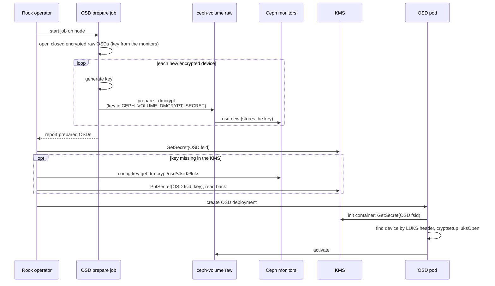

# KMS Support for Encrypted Host-Based OSDs

## Summary

Rook can store the encryption keys of PVC-based OSDs in an external key management system (KMS),
configured with `security.kms` in the CephCluster. Host-based OSDs (OSDs on node devices, configured
with `useAllDevices` or `devices`) cannot use a KMS today. If `encryptedDevice: "true"` is set for
them, the key is always stored in the Ceph monitors, even when `security.kms` is configured. Rook
reports no error or condition when this happens.

The reason is the `ceph-volume` mode Rook picks. Host-based OSDs already use `ceph-volume raw` by
default, but Rook falls back to `ceph-volume lvm` when the device is encrypted. `lvm` mode always
generates its own key and stores it in the monitors. `raw` mode accepts a key from the caller through
the `CEPH_VOLUME_DMCRYPT_SECRET` environment variable, and this is how Rook already supports a KMS
for PVC-based OSDs.

This design proposes to keep encrypted host-based OSDs on `raw` mode when `security.kms` is
configured, and to reuse the existing PVC-based KMS code for them.

Related issues: [#16928](https://github.com/rook/rook/issues/16928),
[#16992](https://github.com/rook/rook/issues/16992).

### Goals

- Encrypted host-based OSDs store their keys in the configured KMS.
- Use the same `security.kms` settings that PVC-based OSDs use. No new CephCluster settings.
- No change for clusters without `security.kms`: unencrypted OSDs stay on `raw` mode, and encrypted
  OSDs stay on `lvm` mode with keys in the monitors.
- Report the encrypted OSDs that cannot use the KMS when `security.kms` is configured.

### Non-Goals

- Replacing `lvm` mode for host-based OSDs.
- Moving the keys of existing OSDs into a KMS. Only new OSDs are affected.
- Removing the copy of the key that `ceph-volume` stores in the monitors (see
  [Keys in the monitors](#keys-in-the-monitors)).
- Key rotation (`security.keyRotation`) for host-based OSDs. This can follow once this design is
  implemented.

## Proposal details

### Configuration

No new settings are needed. An encrypted host-based cluster with a KMS is configured like this:

```yaml
spec:
  security:
    kms:
      connectionDetails:
        KMS_PROVIDER: vault
        VAULT_ADDR: https://vault.default.svc.cluster.local:8200
        VAULT_BACKEND_PATH: rook
        VAULT_SECRET_ENGINE: kv
      tokenSecretName: rook-vault-token
  storage:
    useAllNodes: true
    useAllDevices: true
    config:
      encryptedDevice: "true"
```

The new path is used only when the KMS settings are valid. Today the operator validates
`security.kms` only when the cluster has encrypted PVC-based OSDs
([cluster.go](https://github.com/rook/rook/blob/cdfb3c2fa8dd711e8d3e91bed9f416390f5491d9/pkg/operator/ceph/cluster/cluster.go#L338-L345)).
The same validation runs for clusters with encrypted host-based OSDs, in the OSD reconcile rather
than in the cluster validation. If it fails, for example for a spec without `KMS_PROVIDER`, which
would otherwise select the Kubernetes provider, or while the token Secret does not exist yet, the
operator logs the error and creates no new encrypted host-based OSDs and does not update the
deployments of existing encrypted `raw` mode host OSDs, until the settings are valid. New OSDs are
not put on `lvm` mode instead, since their keys would then never reach the KMS. The rest of the
cluster keeps reconciling, unless it also has encrypted PVC-based OSDs, whose validation stops the
reconcile as today. A KMS that passes validation but fails at runtime, such as a wrong token, has
the same effect on new OSDs (see [Provisioning](#provisioning)).

The new path also requires Ceph v19.2.1 or later, because Ceph v19.2.0 does not write the OSD fsid
into the LUKS2 header (see [Existing OSDs](#existing-osds)). On v19.2.0, encrypted host-based OSDs
stay on `lvm` mode and are reported as described below.

### Which OSDs are affected

Rook chooses the `ceph-volume` mode at two levels (`pkg/daemon/ceph/osd/volume.go`):

- `allowRawMode()` decides for the whole node. It turns off `raw` mode for every device on the node
  when the node-level `encryptedDevice` is set, when `osdsPerDevice` is greater than 1, or when the
  node has a `metadataDevice`.
- `isSafeToUseRawMode()` decides per device. It turns off `raw` mode when the device is an LVM logical
  volume, or when the device's own `encryptedDevice`, `osdsPerDevice` or `metadataDevice` setting
  requires it.

With this design, encryption no longer turns off `raw` mode at either level when a valid
`security.kms` is configured, so both functions change. The other reasons still force `lvm` mode,
because `raw` mode cannot split devices the way `ceph-volume lvm batch` does. Encrypted OSDs in those
cases keep their keys in the monitors only. This includes every encrypted device on a node with a
node-level `metadataDevice`.

The OSD replacement flow (`provisionReplacedOSD()` in `pkg/daemon/ceph/osd/replace.go`) is a third
caller of these predicates. Today it adds `--dmcrypt` only in `lvm` mode, because raw mode was never
encrypted ([osd-replacement.md](osd-replacement.md) assumes this too). It changes with them:

- A replaced OSD that is encrypted and qualifies for `raw` mode is prepared like a new OSD (see
  [Provisioning](#provisioning)), with `--dmcrypt` and a key in `CEPH_VOLUME_DMCRYPT_SECRET`. `raw
  prepare --dmcrypt` fails without that variable (or `--with-tpm`), so the replacement flow must
  set it.
- Closing the dm-crypt mapper of the destroyed OSD also finds `raw` mode mappers. Today it uses only
  `ceph-volume lvm list`.
- The KMS key of the destroyed OSD is left in the KMS, as on OSD removal (see [Cleanup](#cleanup)).

Encrypted partitions are dropped today in `getAvailableDevices()`
([daemon.go](https://github.com/rook/rook/blob/cdfb3c2fa8dd711e8d3e91bed9f416390f5491d9/pkg/daemon/ceph/osd/daemon.go#L448-L451)),
before `lvmModeAllowed()` is reached. With a valid KMS, these gates let them through and they are
created in `raw` mode like whole devices. An earlier attempt to allow encrypted partitions (#12924)
was reverted in 8e80b2103 because they produced unencrypted OSDs, so the implementation adds a test
that an encrypted partition gets a dm-crypt mapper. Encrypted logical volumes stay unsupported.

### Reporting

The encrypted OSDs that cannot use the KMS are listed in the CephCluster status, by reason, like
`status.storage.deprecatedOSDs`:

```yaml
status:
  storage:
    osdsWithoutKMS:
      metadataDevice: [3, 4]
      osdsPerDevice: [7]
      lvmMode: [0, 1, 2]
```

`lvmMode` lists the other encrypted `lvm` mode OSDs, such as those created before the upgrade,
before `security.kms` was set, or on Ceph v19.2.0. Every reason is derived from the OSD deployments
on each reconcile. The map is set only when `security.kms` is configured, and an OSD leaves it when
it is removed or replaced.

### Flow



### Provisioning

For PVC-based OSDs, the operator creates each key in the KMS before the OSD prepare job starts,
because it knows every PVC in advance. For host-based OSDs, the prepare job finds the devices itself,
and `ceph-volume raw prepare` generates the OSD fsid, so the name of the key is only known after
prepare. Each key is stored in the KMS under the OSD fsid, in the same way that PVC-based OSDs use
the PVC name.

`ceph-volume raw prepare` already passes the key to `ceph osd new`, so the monitors hold it under the
OSD fsid (`dm-crypt/osd/<fsid>/luks`) before the device is formatted. The design uses this copy to
hand the key from the prepare job to the operator, so the prepare job never writes to the KMS. For
each new encrypted device, the prepare job:

1. Generates a key and sets `CEPH_VOLUME_DMCRYPT_SECRET` to it, as the PVC prepare job already does,
   and unsets it once `ceph-volume` returns.
2. Runs `ceph-volume raw prepare --dmcrypt`.
3. Reads the OSD fsid from the dm-crypt mapper that `ceph-volume` reports
   (`ceph-<osd fsid>-<kernel name>-block-dmcrypt`).

`ceph-volume raw list` reports an encrypted OSD by its mapper, so the prepare job lists that mapper,
not the device, when it checks that the new OSD is reported.

When the operator processes the prepare result of an encrypted `raw` mode host OSD, it checks that
the KMS holds a key under the OSD fsid. If not, it reads the key from the monitors, stores it in the
KMS and reads it back. It creates the OSD deployment only if the key read back matches. A failure is
retried on the next reconcile, which finds the OSD without a deployment again. Reading the key back
also covers IBM Key Protect, whose `PutSecret()` returns no error when the alias already exists.

A prepare job that is killed after `ceph osd new` needs no recovery of its own: the key is in the
monitors under the OSD fsid, and the operator copies it once the OSD is reported.

[ceph/ceph#68338](https://github.com/ceph/ceph/pull/68338) adds `--osd-fsid` to `raw prepare` in
Ceph v21. With it, the key could be stored in the KMS before prepare. This is not needed while the
monitor copy is kept.

### Existing OSDs

Before it prepares any device, the prepare job looks for the encrypted `raw` mode OSDs on its node:

- A closed OSD is found by its LUKS2 header. From Ceph v19.2.1, `ceph-volume` writes the OSD fsid
  into the subsystem field as `ceph_fsid=<osd fsid>`.
- An open OSD is found by its mapper. Device discovery skips a disk that has a child, and an open
  OSD is a child of its disk.

Only OSDs whose fsid is in `ceph osd dump` are handled, so a purged OSD whose disk was not wiped is
not reported again. The prepare job opens a closed OSD with its key from the monitors, under the
mapper name `ceph-volume` gives it, so that `ceph-volume raw list` reports an OSD that got no
deployment before a reboot.

### KMS access

The prepare job does not touch the KMS, so it needs no KMS settings and no RBAC change. The new
writes (storing the key under the OSD fsid) come from the operator, which already writes PVC keys. The OSD pod reads its key with `rook key-management get`, as PVC-based OSD pods do, so the
OSD pods get the KMS connection settings and the Vault or KMIP certificate mounts that PVC-based OSD
pods already get. The key itself is never part of the pod spec.

### Activation

`ceph-volume raw activate` cannot open an encrypted device by itself. It finds OSDs by reading the
BlueStore label, which can only be read after the device is opened. The OSD pod therefore needs an
init container that fetches the key from the KMS and opens the device before
`ceph-volume raw activate` runs.

The PVC-based init container (`getPVCEncryptionOpenInitContainerActivate()` and
`open-encrypted-block.sh`) does not fit: it takes the key name, the dm-crypt name and the device from
the PVC, and it rewrites the LUKS2 subsystem to the cluster fsid, which erases the OSD fsid that
`ceph-volume` writes there. Host-based OSDs get their own init container, which shares the KMS fetch
(`rook key-management get`) and the KMS volumes with the PVC one. It:

1. Does nothing if the mapper the OSD was created with is already open.
2. Renames a mapper of the same OSD that is open under a different kernel name. The prepare job opens
   a closed OSD under the kernel name the device has now, which can change after a reboot. There is
   no udev in the container to wait for, so the rename does not sync with udev, and the script
   creates the device node itself and fails if the expected mapper is still missing.
3. Otherwise finds the device whose LUKS2 header holds the OSD fsid, so a renamed device is still
   found, fetches the key under the OSD fsid and opens the device under the expected mapper name.
   Paths of a multipath device are skipped, so the device is opened through the multipath device.

An OSD pod opens any encrypted `raw` mode host OSD this way, whatever the current KMS settings, so an
OSD whose KMS settings were removed fails with an error instead of starting without its device.

From Ceph v20.2.3, `ceph-volume raw activate` closes and reopens a dm-crypt mapper that is already
open, with the key from `CEPH_VOLUME_DMCRYPT_SECRET` or, if unset, from the lockbox user and the
monitor copy. Both stay in place, so this works either way.

### Keys in the monitors

The monitor copy of the key (`dm-crypt/osd/<fsid>/luks` and the user `client.osd-lockbox.<fsid>`) is
kept, as it is for PVC-based OSDs today. Keeping it means:

- cephx daemon key rotation keeps rotating the lockbox user of every encrypted OSD
  ([update.go](https://github.com/rook/rook/blob/cdfb3c2fa8dd711e8d3e91bed9f416390f5491d9/pkg/operator/ceph/cluster/osd/update.go#L432-L439))
  without a special case, and `activate-osd.sh` does not change.
- A disk can still be opened when its KMS key is lost, for example when the KMIP uid Secrets are
  deleted with the namespace, or after a downgrade (see [Upgrades and downgrades](#upgrades-and-downgrades)).
  The operator copies the key into the KMS only before it creates the OSD deployment. If the KMS
  loses the key of an OSD that already has a deployment, the OSD keeps running and restarts while
  its mapper is open, but fails to start once the mapper is closed, for example at the next node
  reboot; deleting its deployment lets the next reconcile copy the key from the monitors again and
  recreate it.
- The KMS holds a copy of the key, as it does for PVC-based OSDs, rather than the only copy.

Removing the monitor copy for all KMS-backed OSDs, PVC and host, needs a `ceph-volume` option to leave
the key out of `ceph osd new`. The monitors already accept `osd new` without `dmcrypt_key`, as the
TPM2 path does. Whether the monitor copy is intended for `raw prepare --dmcrypt` is asked upstream in
[ceph/ceph#71378](https://github.com/ceph/ceph/pull/71378). This is left for a follow-up once
`ceph-volume` has such an option.

### Cleanup

Keys of host-based OSDs are named by OSD fsid, so the existing PVC-based cleanup does not find them.

- **Cluster deletion.** Today the operator deletes the KMS keys of PVC-based OSDs by listing the OSD
  PVCs (`pkg/operator/ceph/cluster/controller.go`). The Ceph cluster may already be unreachable at
  this point, so the fsids are not read from Ceph. The operator reads them from the encrypted OSD
  deployments instead (`ROOK_OSD_UUID` of the OSDs with `ROOK_CV_MODE=raw` that are not on a PVC).
  The keys are deleted only when the cleanup policy destroys the data.
- **OSD removal and replacement.** Removing or replacing a single OSD leaves its key in the KMS. The
  OSD removal job is started from a manifest that users apply (`osd-purge.yaml`) and has no KMS
  settings. It would need them to read the fsid of the OSD from the OSD map before it purges the OSD
  and delete the key under that fsid. This is left for a follow-up.

Keys of OSDs whose deployment is already gone are not deleted on cluster deletion.

### Cleanup of devices from other clusters

`wipeDevicesFromOtherClusters` reads the `ceph_fsid=` field of a LUKS2 header as the cluster fsid,
but host-based `raw` mode OSDs have their OSD fsid there, so closed OSDs of this cluster would be
wiped after a reboot. The check also keeps a device whose fsid is an OSD in `ceph osd dump`. It reads
the OSD map only when it finds a LUKS2 header with a fsid other than the cluster fsid.

### Code reuse

The existing KMS code (`kms.NewConfig()`, `PutSecret()`, `GetSecret()`, `ConfigToEnvVar()`,
`rook key-management get`) is reused with the key name as a parameter. The operator's KMS setup for
Vault tokens, IBM Key Protect and KMIP moves into one helper shared by cluster deletion and the copy
of the key into the KMS, and one helper builds the KMS volumes of the OSD pods.

### Upgrades and downgrades

- **Upgrades.** Existing OSDs are not changed. On a cluster that already has a valid `security.kms`,
  every new encrypted host-based OSD that qualifies for `raw` mode, replacements included, uses the
  KMS after the upgrade, without a CR change. Such an OSD then needs the KMS to start, while the
  older `lvm` mode OSDs on the same node do not. Encrypted partitions on clusters with
  `useAllDevices` also start being used as new OSDs. PendingReleaseNotes states both, and the
  partition row of the device table in `ceph-cluster-crd.md` is updated. On a cluster whose
  `security.kms` is invalid, no new encrypted host-based OSDs are created until it is fixed (see
  [Configuration](#configuration)).
- **Downgrades.** Rook does not document support for downgrading a minor release. A Rook release
  without this design cannot open an encrypted `raw` mode host OSD, so the OSD fails to start at the
  next reboot. PendingReleaseNotes names the minimum Rook version for these OSDs and the manual
  recovery: read the key with `ceph config-key get dm-crypt/osd/<fsid>/luks` and open the device with
  `cryptsetup luksOpen` under the mapper name `ceph-<osd fsid>-<kernel name>-block-dmcrypt`.

### Risks and Mitigation

- **Invalid KMS settings block new encrypted OSDs.** While `security.kms` fails validation, for
  example because the token Secret is created after the CephCluster, no new encrypted host-based
  OSDs are created. The operator logs the validation error on each reconcile.
- **Some encrypted OSDs still cannot use the KMS.** OSDs with a metadata device or with
  `osdsPerDevice` greater than 1 stay on `lvm` mode. Rook lists them in `status.storage.osdsWithoutKMS`
  instead of ignoring `security.kms` silently. Encrypted OSDs on logical volumes remain unsupported.
- **The key stays in the monitors.** This is the same as for PVC-based OSDs.
  [CVE-2026-50152](https://docs.ceph.com/en/latest/security/CVE-2026-50152/) made the config-key
  store, dm-crypt keys included, readable by any identity with `mon r`. It is fixed in Ceph v19.2.6
  and v20.2.4.
- **KMS outage.** An encrypted `raw` mode host OSD fetches its key from the KMS when its pod starts,
  so it does not start while the KMS is unreachable, as for PVC-based OSDs.
- **`ceph-volume` versions.** The OSD fsid is read from the mapper name `ceph-volume` gives an
  encrypted `raw` OSD, and from the `ceph_fsid=` it writes to the LUKS2 subsystem from v19.2.1.
  The mapper name is the same from v19.2.0 to v21.3.0. `ceph-volume raw list <mapper>` reports the
  fsid without relying on the mapper name, and can replace the parsing if a later version differs.
- **Load on the KMS.** The operator reads the key of an encrypted `raw` mode host OSD only while the
  OSD has no deployment, once per reconcile until the deployment is created.

## Prototype

A prototype is on
[`ideepika:wip-kms-host-osd-prototype`](https://github.com/ideepika/rook/tree/wip-kms-host-osd-prototype).
The branch has the earlier revision of this design, which deleted the monitor copy; the changes for
this revision were tested from a local working tree and will be pushed to it. They implement the
design above except the `osdsWithoutKMS` status, deleting the key on OSD removal, and running the
KMS validation in the OSD reconcile (the prototype validates with the cluster spec, so an invalid
`security.kms` stops the whole reconcile). The operator
tells the prepare job to use `raw` mode for encrypted devices with one environment variable; the
prepare job gets no KMS settings.

It was tested on a single-node k3s cluster with Ceph v20.2.4, Vault in dev mode without TLS, and an
encrypted OSD on a loop device:

- A new OSD is created on the first prepare run. The operator stores its key in Vault under the OSD
  fsid before it creates the deployment, the key in Vault matches the monitor copy and opens the
  device, the lockbox user exists, and the LUKS2 subsystem holds `ceph_fsid=<osd fsid>`.
- After its mapper is closed, as after a reboot, the OSD pod opens the device with the key from
  Vault.
- When the key is deleted from Vault and the deployment is deleted, the next reconcile copies the
  key from the monitors again and recreates the OSD.
- With an invalid Vault token, the OSD gets no deployment and the operator reports the failure.
  Once the token is restored, the next reconcile stores the key and creates the OSD.
- An OSD whose deployment was deleted and whose mapper was closed is opened by the prepare job with
  the monitor key, reported again, and recreated, without a new write to the KMS.

The test also showed why the monitor copy is kept. The dev-mode Vault restarted during the test
period and lost its keys. An OSD created by the earlier revision of this design, which deleted the
monitor copy, then had no copy of its key left, and could no longer be opened once its mapper was
closed. With this revision, the key can be copied from the monitors again (third test above, where
the OSD deployment was deleted for the copy to run).

Not tested yet: real disks, multipath, partitions, OSD replacement, the KMIP and IBM Key Protect
providers, Vault with TLS, Ceph v19.2, cephx daemon key rotation, and cluster deletion.
