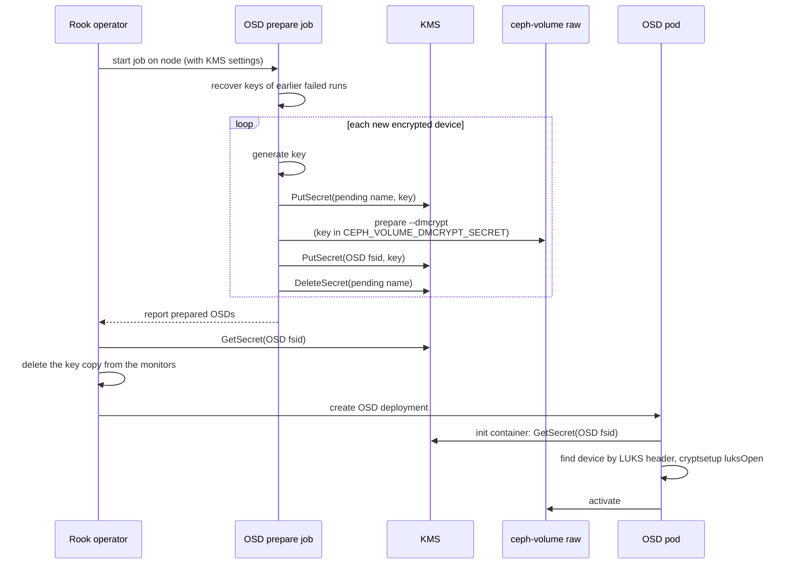

# KMS Support for Encrypted Host-Based OSDs

## Summary

Rook can store the encryption keys of PVC-based OSDs in an external key management system (KMS),
configured with `security.kms` in the CephCluster. Host-based OSDs (OSDs on node devices, configured
with `useAllDevices` or `devices`) cannot use a KMS today. If `encryptedDevice: "true"` is set for
them, the key is always stored in the Ceph monitors, even when `security.kms` is configured. Rook
reports no error or condition when this happens.

The reason is the `ceph-volume` mode Rook picks. Host-based OSDs already use `ceph-volume raw` by
default, but Rook falls back to `ceph-volume lvm` when the device is encrypted. `lvm` mode always
generates its own key and stores it in the monitors. `raw` mode accepts a key from the caller through
the `CEPH_VOLUME_DMCRYPT_SECRET` environment variable, and this is how Rook already supports a KMS
for PVC-based OSDs.

This design proposes to keep encrypted host-based OSDs on `raw` mode when `security.kms` is
configured, and to reuse the existing PVC-based KMS code for them.

Related issues: [#16928](https://github.com/rook/rook/issues/16928),
[#16992](https://github.com/rook/rook/issues/16992).

### Goals

- Encrypted host-based OSDs store their keys in the configured KMS.
- Use the same `security.kms` settings that PVC-based OSDs use. No new CephCluster settings.
- No change for clusters without `security.kms`: unencrypted OSDs stay on `raw` mode, and encrypted
  OSDs stay on `lvm` mode with keys in the monitors.
- Report a condition on the CephCluster when `security.kms` is configured but an OSD cannot use it.

### Non-Goals

- Replacing `lvm` mode for host-based OSDs.
- Moving the keys of existing OSDs into a KMS. Only new OSDs are affected.
- Key rotation (`security.keyRotation`) for host-based OSDs. This can follow once this design is
  implemented.

## Proposal details

### Configuration

No new settings are needed. An encrypted host-based cluster with a KMS is configured like this:

```yaml
spec:
  security:
    kms:
      connectionDetails:
        KMS_PROVIDER: vault
        VAULT_ADDR: https://vault.default.svc.cluster.local:8200
        VAULT_BACKEND_PATH: rook
        VAULT_SECRET_ENGINE: kv
      tokenSecretName: rook-vault-token
  storage:
    useAllNodes: true
    useAllDevices: true
    config:
      encryptedDevice: "true"
```

### Which OSDs are affected

Rook chooses the `ceph-volume` mode at two levels (`pkg/daemon/ceph/osd/volume.go`):

- `allowRawMode()` decides for the whole node. It turns off `raw` mode for every device on the node
  when the node-level `encryptedDevice` is set, when `osdsPerDevice` is greater than 1, or when the
  node has a `metadataDevice`.
- `isSafeToUseRawMode()` decides per device. It turns off `raw` mode when the device is an LVM logical
  volume, or when the device's own `encryptedDevice`, `osdsPerDevice` or `metadataDevice` setting
  requires it.

With this design, encryption no longer turns off `raw` mode at either level when `security.kms` is
configured, so both functions change. The other reasons still force `lvm` mode, because `raw` mode
cannot split devices the way `ceph-volume lvm batch` does. Encrypted OSDs in those cases keep their
keys in the monitors, and Rook reports a condition for them. This includes every encrypted device on
a node with a node-level `metadataDevice`.

Encrypted OSDs on partitions are skipped entirely today (`lvmModeAllowed()`). With a KMS, they can
be created in `raw` mode like whole devices.

### Flow



### Provisioning

For PVC-based OSDs, the operator creates each key in the KMS before the OSD prepare job starts,
because it knows every PVC in advance. For host-based OSDs, the prepare job finds the devices itself,
so the operator does not know which keys to create. The key is therefore created by the prepare job.

Each OSD key is stored in the KMS under the OSD fsid, in the same way that PVC-based OSDs use the PVC
name. `ceph-volume raw prepare` generates the fsid itself, so the fsid is only known after prepare.
Until then the key is stored under a pending name:

```text
pending-<node>-<16 hex characters of the SHA-256 of a stable udev link of the device>
```

The link is the first of the device's `/dev/disk/by-id`, `by-path` or `by-loop-ref` links, leaving
out links that change with the device content (`lvm-pv-uuid-`, and device-mapper links other than the
WWID of a multipath device). The name stays the same when the kernel renames the device after a
reboot, and the hash makes it a valid Kubernetes Secret name and Vault path. The prepare job skips an
encrypted device whose udev links it cannot read, with an error, rather than falling back to the
kernel name.

For each new encrypted device, the prepare job:

1. Deletes any pending key for the device left by an earlier attempt, generates a key and stores it
   under the pending name. It then reads the pending key back. If the KMS returns a different key,
   the device is skipped with an error, because IBM Key Protect keeps the alias of a deleted key, and
   the key of the new OSD would otherwise be lost. A failed read only logs a warning, since the key
   was stored. A skipped device does not stop the other devices on the node from being prepared.
2. Sets `CEPH_VOLUME_DMCRYPT_SECRET` to the key, as the PVC prepare job already does, and unsets it
   once `ceph-volume` returns.
3. Runs `ceph-volume raw prepare --dmcrypt`. If it fails, the pending key is kept, because the OSD
   may exist.
4. Reads the OSD fsid from the dm-crypt mapper that `ceph-volume` reports
   (`ceph-<osd fsid>-<kernel name>-block-dmcrypt`) and stores the key under that fsid. If the fsid
   cannot be found, the job fails and the key stays under the pending name.
5. Deletes the pending key.

`ceph-volume raw list` reports an encrypted OSD by its mapper, so the prepare job lists that mapper,
not the device, when it checks that the new OSD is reported.

`DeleteSecret()` also deletes the Kubernetes Secret of the Kubernetes and KMIP providers. Today it
does not, and `PutSecret()` does nothing while that Secret exists, so a stale pending key would
never be replaced.

### Existing OSDs and crash recovery

Before it prepares any device, the prepare job looks for the encrypted `raw` mode OSDs on its node:

- A closed OSD is found by its LUKS2 header. `ceph-volume` writes the OSD fsid into the subsystem
  field as `ceph_fsid=<osd fsid>`.
- An open OSD is found by its mapper. Device discovery skips a disk that has a child, and an open
  OSD is a child of its disk.

Only OSDs whose fsid is in `ceph osd dump` are handled, so a purged OSD whose disk was not wiped is
not reported again. For each of them, the prepare job:

- Moves the pending key of the device to the OSD fsid if one exists, which happens when a prepare run
  failed after `ceph-volume` created the OSD. The key is moved only if it opens the device
  (`cryptsetup luksOpen --test-passphrase`), and never replaces a different key already stored under
  the fsid.
- Opens a closed OSD with its key from the KMS, under the mapper name `ceph-volume` gives it, so that
  `ceph-volume raw list` reports an OSD that got no deployment before a reboot.

### RBAC and KMS permissions

Today only the operator writes to the KMS. With this design the prepare job writes to it too, which
works for Vault, but not yet for the providers that keep a Kubernetes Secret per key:

- The prepare job runs as `rook-ceph-osd`, whose Role only grants `get` and `update` on Secrets. The
  Kubernetes and KMIP providers keep a Kubernetes Secret per key (the key itself, or the KMIP unique
  identifier), so `PutSecret()` and `DeleteSecret()` fail in the prepare job with these providers.
- For Vault with Kubernetes authentication, the Vault role bound to `rook-ceph-osd` needs write and
  delete access to the key path, as the operator's role already has.

This is an open question for review. The options are:

1. Extend the `rook-ceph-osd` Role in `common.yaml` and the Helm chart with `create` and `delete` on
   Secrets. This is the smaller change, but every OSD pod could then create and delete Secrets in the
   cluster namespace.
2. Keep all KMS writes in the operator. The prepare job would report each new key to the operator
   through its status, and the operator would store it, as it does for PVC-based OSDs. The Role does
   not change, but the key passes through the status ConfigMap, which must then be handled like a
   Secret.

The prepare job gets the KMS connection settings and the Vault or KMIP certificate mounts that
PVC-based prepare jobs already get in `provision_spec.go`, when the node has an encrypted device and
a KMS is configured. The key itself is never part of the pod spec.

### Activation

`ceph-volume raw activate` cannot open an encrypted device by itself. It finds OSDs by reading the
BlueStore label, which can only be read after the device is opened. The OSD pod therefore needs an
init container that fetches the key from the KMS and opens the device before
`ceph-volume raw activate` runs.

The PVC-based init container (`getPVCEncryptionOpenInitContainerActivate()` and
`open-encrypted-block.sh`) does not fit: it takes the key name, the dm-crypt name and the device from
the PVC, and it rewrites the LUKS2 subsystem to the cluster fsid, which erases the OSD fsid that
`ceph-volume` writes there. Host-based OSDs get their own init container, which shares the KMS fetch
(`rook key-management get`) and the KMS volumes with the PVC one. It:

1. Does nothing if the mapper the OSD was created with is already open.
2. Renames a mapper of the same OSD that is open under a different kernel name. The prepare job opens
   a closed OSD under the kernel name the device has now, which can change after a reboot. There is
   no udev in the container to wait for, so the rename does not sync with udev, and the script
   creates the device node itself and fails if the expected mapper is still missing.
3. Otherwise finds the device whose LUKS2 header holds the OSD fsid, so a renamed device is still
   found, fetches the key under the OSD fsid and opens the device under the expected mapper name.
   Paths of a multipath device are skipped, so the device is opened through the multipath device.

An OSD pod opens any encrypted `raw` mode host OSD this way, whatever the current KMS settings, so an
OSD whose KMS settings were removed fails with an error instead of starting without its device.

`activate-osd.sh` recreates the `client.osd-lockbox.<fsid>` user on every start of an encrypted OSD
(`auth get-or-create`). That copy is only used by `lvm` mode, so the script does this for `lvm` mode
only. Otherwise the user deleted below would come back on every restart.

### Keys in the monitors

`ceph-volume raw prepare` includes the key in the secrets it passes to `ceph osd new`, so the
monitors also store it, as the config-key `dm-crypt/osd/<fsid>/luks` with the user
`client.osd-lockbox.<fsid>`. `raw` mode OSDs do not use this copy, because the init container opens
the device with the key from the KMS.

The operator deletes the copy when it processes the prepare result, and creates the OSD deployment
only after that. It checks for the config-key with `ceph config-key exists`, then checks that the
KMS holds the key under the OSD fsid, because the monitors hold the only copy under the fsid if the
prepare job failed to move the pending key. It then deletes the lockbox user and the config-key. The
operator does this, rather than the prepare job, so that the OSD deployment is created only once the
monitors no longer hold the key, and a failure is retried on the next reconcile, which finds the
OSD without a deployment again. The user is deleted first, so that a failure in between leaves the
config-key for the retry to find.

A `ceph-volume` option to leave the key out of `ceph osd new` would make this step unnecessary, and
can follow as an upstream change.

### Cleanup

Keys of host-based OSDs are named by OSD fsid, so the existing PVC-based cleanup does not find them.

- **Cluster deletion.** Today the operator deletes the KMS keys of PVC-based OSDs by listing the OSD
  PVCs (`pkg/operator/ceph/cluster/controller.go`). The Ceph cluster may already be unreachable at
  this point, so the fsids are not read from Ceph. The operator reads them from the encrypted OSD
  deployments instead (`ROOK_OSD_UUID` of the OSDs with `ROOK_CV_MODE=raw` that are not on a PVC).
  These keys are the only way to open the disks, so they are deleted only when the cleanup policy
  destroys the data.
- **OSD removal.** Removing a single OSD leaves its key in the KMS. The OSD removal job is started from
  a manifest that users apply (`osd-purge.yaml`) and has no KMS settings. It would need them to read
  the fsid of the OSD from the OSD map before it purges the OSD and delete the key under that fsid.
  This is left for a follow-up.

Keys of OSDs whose deployment is already gone, and pending keys of failed prepare runs, are not
deleted on cluster deletion (see Risks).

### Cleanup of devices from other clusters

`wipeDevicesFromOtherClusters` reads the `ceph_fsid=` field of a LUKS2 header as the cluster fsid,
but host-based `raw` mode OSDs have their OSD fsid there, so closed OSDs of this cluster would be
wiped after a reboot. The check also keeps a device whose fsid is an OSD in `ceph osd dump`. It reads
the OSD map only when it finds a LUKS2 header with a fsid other than the cluster fsid.

### Code reuse

The existing KMS code (`kms.NewConfig()`, `PutSecret()`, `GetSecret()`, `DeleteSecret()`,
`ConfigToEnvVar()`, `rook key-management get`) is reused with the key name as a parameter. The
operator's KMS setup for Vault tokens, IBM Key Protect and KMIP moves into one helper shared by
cluster deletion and the removal of the monitor copy, and one helper builds the KMS volumes of the
prepare and OSD pods.

### Risks and Mitigation

- **Some encrypted OSDs still cannot use the KMS.** OSDs with a metadata device, with
  `osdsPerDevice` greater than 1, or on logical volumes stay on `lvm` mode. Rook reports a condition
  for them instead of ignoring `security.kms` silently.
- **Upgrades.** Existing OSDs are not changed. Only new encrypted OSDs use the new path.
- **KMS writes from the prepare job.** See [RBAC and KMS permissions](#rbac-and-kms-permissions). The
  prepare job already runs privileged on the node with the `client.admin` key.
- **`ceph-volume` versions.** The OSD fsid is read from the mapper name `ceph-volume` gives an
  encrypted `raw` OSD, and from the `ceph_fsid=` it writes to the LUKS2 subsystem. Both were checked
  on Ceph v20.2.4 only. `ceph-volume raw list <mapper>` reports the fsid without relying on the
  mapper name, and can replace the parsing if other versions differ.
- **Load on the KMS.** Every prepare run reads the key of each encrypted OSD on its node. OSDs that
  have a deployment can be skipped if this load matters.
- **Unused keys in the KMS.** If the prepare pod is killed after storing a key but before
  `ceph-volume` creates the OSD, the key stays in the KMS under its pending name. The next prepare
  run on the same device deletes it and generates a new key, so the unused key is never used by
  mistake. If the device is never prepared again, the pending key is left behind.

## Prototype

A prototype of this design is on
[`ideepika:wip-kms-host-osd-prototype`](https://github.com/ideepika/rook/tree/wip-kms-host-osd-prototype).
It implements everything above except:

- the condition on the CephCluster for encrypted OSDs that cannot use the KMS,
- the RBAC change, which waits for the decision above,
- deleting the key on OSD removal.

It was tested on a single-node k3s cluster with Ceph v20.2.4, Vault in dev mode without TLS, and an
encrypted OSD on a loop device:

- A new OSD is created on the first prepare run, its key is stored under its fsid, and the monitors no
  longer hold it.
- After its mapper is closed, as after a reboot, the OSD pod opens the device with the key from the
  KMS.
- With a Vault token that can only write pending keys, so storing the key under the fsid fails: the
  OSD is not created and the monitors keep their copy. Once the token is restored, the next prepare
  run moves the pending key, both with the mapper open and after it was closed, and the OSD starts.
- A pending key that does not open the device is left alone, and the OSD is not created.
- An OSD whose deployment was deleted and whose mapper was closed is opened by the prepare job,
  reported again, and recreated.

Not tested yet: real disks, multipath, the KMIP and IBM Key Protect providers, Vault with TLS, and
cluster deletion.
